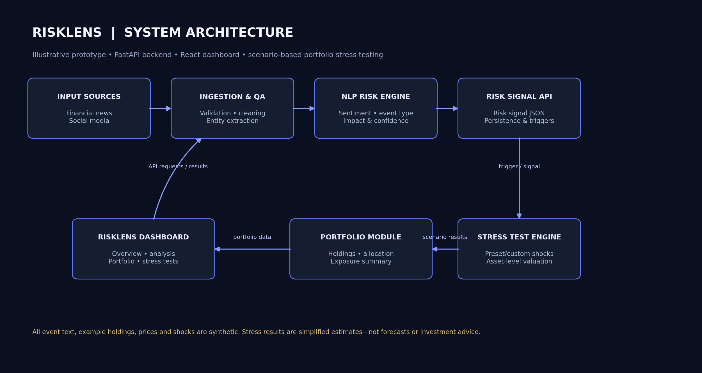

# RiskLens — AI-Powered Financial Risk Intelligence
### S&P Global & CRISIL Campus Hackathon 2026

**Candidate Name:** Deshika Gupta  
**College Email ID:** `deshika034bteceai23@igdtuw.ac.in`  
**College / Campus:** Indira Gandhi Delhi Technical University for Women (IGDTUW)  
**Demo Video Link:** `[Add your unlisted YouTube link]`  
**Slide Deck:** [View presentation PDF](docs/presentation.pdf)

## 1. Project Overview / Problem Statement & Approach

Financial risk signals can emerge from unstructured information such as financial news and social-media discussions. Manually reviewing these sources and translating individual events into potential portfolio risks can be time-consuming. RiskLens addresses this problem by providing a prototype pipeline that converts financial text into structured, interpretable risk signals and connects those signals to portfolio stress testing.

The platform accepts financial text, performs preprocessing and data-quality checks, and estimates sentiment, event classification, event confidence, and impact on a 1–10 scale. The resulting risk signal can be evaluated against configured trigger conditions to determine whether a portfolio stress test should be run.

RiskLens also provides a portfolio management and stress-testing dashboard. Users can manage portfolio holdings, inspect asset-class exposure, apply predefined or custom percentage shocks, and review estimated portfolio-level and asset-level losses. The system is intended to demonstrate an end-to-end risk intelligence workflow using transparent assumptions and synthetic data.

## 2. Architecture & Tech Stack

### Architecture



**Data flow:**

1. **Input:** Financial news or social-media text is submitted for analysis.
2. **Preprocessing and quality checks:** Input validation, text normalization, and entity extraction prepare the data for analysis.
3. **Risk signal generation:** The risk engine estimates sentiment, event type, confidence, and impact, producing a structured signal.
4. **Portfolio assessment:** Configured trigger conditions can connect an event signal to a portfolio stress test.
5. **Stress testing:** Preset scenarios or custom asset-class shocks are applied to calculate illustrative changes in portfolio value.
6. **Dashboard and API:** The frontend presents analysis results, holdings, portfolio allocation, and stress-test outputs through the backend API.

### Technology Stack

- **Frontend:** React, Vite, Recharts, Lucide React
- **Backend:** Python, FastAPI
- **Validation and schemas:** Pydantic
- **Data storage:** MongoDB integration, as configured by the application
- **Scenario configuration:** YAML
- **Testing:** pytest
- **Data formats:** CSV and JSONL

## 3. Dataset Used

The repository includes synthetic demonstration data under `data/`:

- `synthetic_financial_events.jsonl` — fictional financial-event text representing financial-news and social-media source categories.
- `synthetic_portfolio.csv` — fictional portfolio holdings, asset classes, and illustrative valuations.
- `data/README.md` — description of the demonstration data and assumptions.

**Data source:** Synthetic examples created for this prototype. No proprietary, confidential, or client data is intentionally included.

**Assumptions and limitations:**

- Example companies, event records, holdings, and prices are fictional.
- Portfolio values and scenario shocks are illustrative inputs, not live market data.
- Event classification, sentiment, confidence, and impact estimates depend on the implemented analysis logic and input quality.
- Stress-test results are simplified scenario estimates. They are not forecasts, calibrated market-risk measures, or investment advice.

## 4. Quickstart & Installation

**Runtime:** Python 3 and Node.js with npm. Developed and tested locally on macOS.

### Prerequisites

- Python 3.11 or a compatible version supported by the backend dependencies
- Node.js and npm compatible with the installed Vite version
- MongoDB, if required by the selected backend configuration

### Step 1: Clone the repository

Replace the placeholder with the final public repository URL.

```bash
git clone <YOUR_PUBLIC_GITHUB_REPOSITORY_URL>
cd <YOUR_REPOSITORY_FOLDER>
```

### Step 2: Configure and run the backend

Open a terminal at the project root:

```bash
cd backend
python3 -m venv .venv
source .venv/bin/activate
python -m pip install -r requirements.txt
```

Configure the required environment variables locally, using the project's configuration as a reference. Do not commit `.env` files, API keys, passwords, or database credentials.

Start the API:

```bash
uvicorn app.main:app --reload --host 127.0.0.1 --port 8000
```

The API should be available at `http://127.0.0.1:8000`. Interactive API documentation is available at `http://127.0.0.1:8000/docs` when the server is running.

### Step 3: Run the frontend

Open a second terminal at the repository root:

```bash
cd frontend
npm install
npm run dev
```

Open the local URL printed by Vite, typically `http://localhost:5173`.

The frontend development server proxies API requests to the backend at `http://127.0.0.1:8000`, as configured in `frontend/vite.config.js`.

### Step 4: Run tests and build the frontend

From the repository root, run the backend tests:

```bash
cd backend
source .venv/bin/activate
pytest
```

In another terminal, build the frontend:

```bash
cd frontend
npm run build
```

### Main API endpoints

| Method | Endpoint | Purpose |
|---|---|---|
| GET | `/health` | Check backend health |
| POST | `/api/v1/ingestion/preview` | Preview incoming data |
| POST | `/api/v1/ingestion/ingest` | Ingest records |
| POST | `/api/v1/ingestion/upload` | Upload ingestion input |
| POST | `/api/analyze` | Generate a risk signal |
| GET | `/api/portfolio` | Retrieve portfolio holdings and summary |
| POST | `/api/portfolio` | Add a portfolio asset |
| PUT | `/api/portfolio/{asset_id}` | Update a portfolio asset |
| DELETE | `/api/portfolio/{asset_id}` | Delete a portfolio asset |
| POST | `/api/stress-test` | Run a portfolio stress test |

## 5. Key Results & Domain Impact

RiskLens demonstrates an integrated workflow connecting financial text analysis to portfolio-level risk assessment.

- **Structured event intelligence:** Converts submitted financial text into a risk signal containing sentiment, event classification, impact, confidence, and related metadata.
- **Portfolio visibility:** Displays holdings, asset-class allocation, and exposure using data returned by the backend.
- **Scenario-based stress testing:** Estimates portfolio value changes and losses under configured or custom percentage shocks.
- **API-driven design:** Separates the analysis engine, portfolio operations, stress-testing services, and dashboard for easier testing and extension.
- **Validation:** Backend functionality is covered by automated pytest tests, and the frontend has a production build configuration.

### Domain impact

The prototype illustrates how structured event signals can help analysts identify potentially relevant developments, examine portfolio concentrations, and explore downside scenarios in one workflow. Its emphasis on explicit assumptions and interpretable outputs makes the analysis easier to demonstrate and review.

### Limitations and future improvements

The prototype does not provide a live financial-news feed or calibrated predictions of market movements. Further work could include evaluation against labelled public financial-event datasets, improved source-reliability assessment, scenario calibration with domain experts, stronger monitoring, and production deployment safeguards.

## License

This project is released under the MIT License. See [LICENSE](LICENSE) for details.

## Submission Links

- **Public GitHub repository:** `[Add your repository URL]`
- **10-minute demo video:** `[Add your unlisted YouTube link]`
- **Presentation deck:** [docs/presentation.pdf](docs/presentation.pdf)
- **Architecture diagram:** [docs/architecture.png](docs/architecture.png)

The demo video and presentation should be accessible to reviewers. Verify the public repository and unlisted video in a private/incognito browser window before submission.